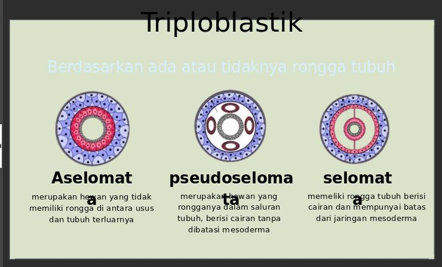
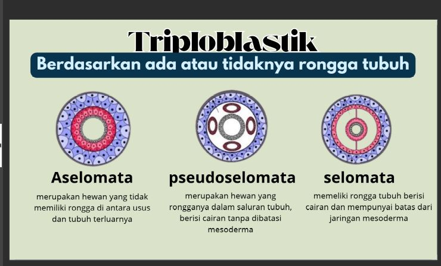

# Canva to PowerPoint Converter

A simple Python script that converts Canva slide images into a PowerPoint (`.pptx`) presentation.

This project provides a workaround for Canva-to-PowerPoint export issues, such as:
- Font changes
- Broken layouts
- Missing elements
- Misaligned objects

Instead of exporting directly to PPTX, this tool converts each exported slide image into a separate PowerPoint slide.

## Features

- Convert multiple slide images into one PPTX file.
- Supports PNG, JPG, and JPEG.
- Automatically sorts filenames using natural sorting.
- Preserves the original slide appearance.
- Automatically detects the image dimensions.
- Maintains the original aspect ratio.
- Supports multiple slides in a single ZIP archive.

## Requirements

- Python 3
- Pillow
- python-pptx

Install the required libraries:

```bash
pip install pillow python-pptx
```

## How to Use

### 1. Download Your Canva Presentation

Open your presentation in Canva.

1. Click **Share** in the top-right corner.
2. Select **Download**.
3. Choose **PNG** as the file type.
4. Select **All pages** to download every slide.
5. Click **Download**.

<details>
<summary>Why PNG?</summary>

PNG preserves the visual appearance of your slides, including fonts, images, colors, and other design elements.

This helps avoid many of the compatibility issues that can happen when exporting directly to PPTX.

</details>

### 2. Prepare Your ZIP File

Canva will download your slides as a ZIP archive containing the individual PNG images.

Keep the ZIP file intact. You do not need to extract it manually.

Example:

```text
presentation.zip
├── 1.png
├── 2.png
├── 3.png
├── 4.png
└── ...
```

Make sure the filenames reflect the intended slide order.

### 3. Download This Repository

Clone the repository:

```bash
git clone https://github.com/rybert79/canva-to-pptx.git
cd canva-to-pptx
```

Or download the repository as a ZIP file from GitHub.

### 4. Configure the Script

Open the Python script and edit these two variables:

```python
# path
zip_path = ""  # file tujuan
out_path = ""  # tempat hasil file disimpan
```

For example:

```python
zip_path = "presentation.zip"
out_path = "presentation.pptx"
```

You can also use absolute paths:

```python
zip_path = "/home/user/Downloads/presentation.zip"
out_path = "/home/user/Downloads/presentation.pptx"
```

### 5. Run the Script

Execute the script using Python:

```bash
python3 main.py
```

If everything works correctly, you will see output similar to:

```text
succeed make 77 slide.
Resolution first image: 1920 × 1080 px
File out: presentation.pptx
```

Your PowerPoint presentation is now ready!

## Before & After

### Before — Direct Canva Export


### After — Converted with This Tool

## How It Works

The script uses three main libraries:

| Library | Purpose |
|---|---|
| `zipfile` | Reads images directly from the ZIP archive. |
| `Pillow` | Detects image dimensions. |
| `python-pptx` | Creates and generates PowerPoint presentations. |

The script performs the following operations:

1. Reads all supported images from the ZIP archive.
2. Ignores hidden files and macOS metadata.
3. Sorts filenames using natural sorting.
4. Detects the dimensions of the first image.
5. Creates a PowerPoint presentation with the corresponding aspect ratio.
6. Adds each image as a full-slide picture.
7. Saves the final PPTX file.

## Important Notes

**This method prioritizes visual consistency over editability.**

- Each slide is converted into a single full-slide image.
- Text and individual design elements cannot be edited separately.
- The original visual appearance is preserved as much as possible.
- The resulting PPTX file may be larger because it contains all the slide images.
- All slides are fitted to the dimensions of the first image.

If you need to edit individual text or design elements, this method is not suitable.

## Project Structure

```text
canva-to-pptx/
├── main.py
├── README.md
└── presentation.zip
```

## License

This project is open-source. Feel free to use, modify, and improve it.

---

**Made with Python.**

A small workaround for a frustrating Canva export problem.
